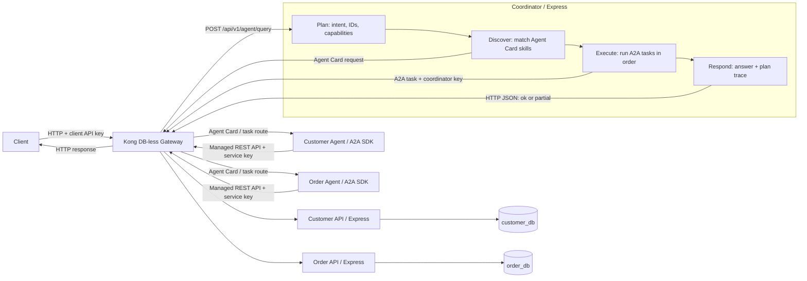
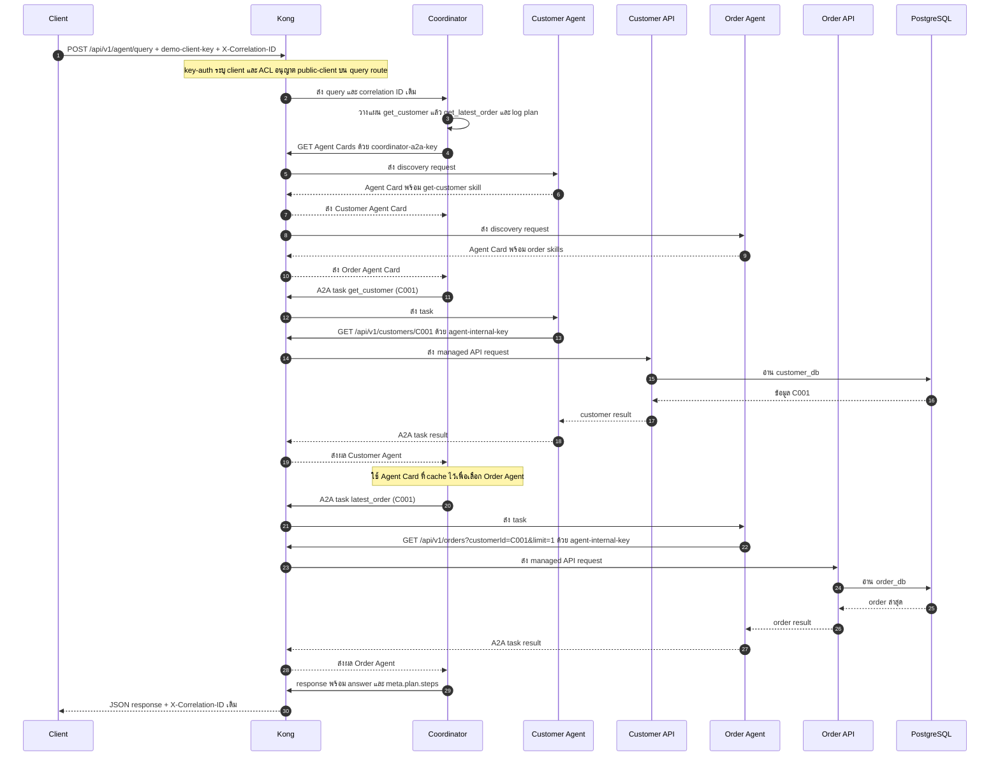

# Customer Service Integration Platform

ต้นแบบสำหรับ Technical Assessment ของ Partilon: บริการ Customer และ Order แยกกัน มี Kong เป็น API Gateway และมี Agent ที่ทำงานร่วมกันผ่าน A2A

## Architecture



ทุก service เขียนด้วย Express + TypeScript โดย Customer API และ Order API ใช้ PostgreSQL คนละ database คนละ role (แต่อยู่ใน container เดียวกัน) ส่วน Agent ไม่มีสิทธิ์เข้าถึงฐานข้อมูลโดยตรง ต้องเรียกผ่าน API เท่านั้น

## Getting Started

ต้องมี Docker Desktop (รองรับ Compose) และพอร์ต `8000` ว่างอยู่

```powershell
# ไม่บังคับ: คัดลอกเฉพาะเมื่อต้องการปรับค่าเริ่มต้นของ Compose
Copy-Item .env.example .env
docker compose up --build -d
docker compose ps
```

ไม่จำเป็นต้องสร้าง `.env` เพื่อเริ่มระบบ ถ้าไม่มี Compose จะใช้ค่าเริ่มต้นใน `docker-compose.yml` ไฟล์ `.env` ถูกละเว้นโดย Git ส่วน `.env.example` อยู่ใน repository และแสดงค่าที่ปรับได้ ได้แก่ host port, timeout, log level และรหัสผ่าน PostgreSQL ส่วน demo API keys และรหัสผ่านของ database role อยู่ใน `kong/kong.yml` และ `db/init.sql` เป็นค่า demo เท่านั้น

เมื่อทุก service ขึ้นสถานะ `healthy` ให้เรียกผ่าน `http://localhost:8000` โดยส่ง `demo-client-key` ใน header `apikey`:

```powershell
curl.exe -H "apikey: demo-client-key" http://localhost:8000/api/v1/customers/C001
curl.exe -H "apikey: demo-client-key" http://localhost:8000/api/v1/orders/O1001
curl.exe -H "apikey: demo-client-key" "http://localhost:8000/api/v1/orders?customerId=C001&limit=1"
curl.exe --% -X POST http://localhost:8000/api/v1/agent/query -H "apikey: demo-client-key" -H "Content-Type: application/json" -d "{\"query\":\"Find customer C001 and tell me their latest order status\"}"
curl.exe --% -X POST http://localhost:8000/api/v1/agent/query -H "apikey: demo-client-key" -H "Content-Type: application/json" -d "{\"query\":\"Show all orders for C001\"}"
```

หยุดระบบด้วย `docker compose down` (ข้อมูลยังอยู่ใน volume) หรือ `docker compose down -v` ถ้าต้องการล้าง database และ seed ทั้งหมด

## API

| Method | Route | รายละเอียด |
|---|---|---|
| GET | `/api/v1/customers/{customerId}` | อ่านข้อมูล customer |
| GET | `/api/v1/orders/{orderId}` | อ่านข้อมูล order |
| GET | `/api/v1/orders?customerId=C001&limit=50&offset=0` | รายการ order เรียงใหม่ไปเก่า แบ่งหน้า (`limit` 1–50, `offset` 0–1,000,000) |
| POST | `/api/v1/agent/query` | ส่งคำถามให้ Coordinator |

API ฉบับเต็มอยู่ที่ [openapi/openapi.yaml](openapi/openapi.yaml) และมี [Postman collection](postman/Partilon-Assessment.postman_collection.json) สำหรับทดสอบ API ด้วยมือ

## Demo Scenarios

ตารางนี้ตรงกับ 9 สถานการณ์ในหัวข้อ Required Demonstration

| # | Scenario | วิธีสาธิต | ผลที่คาดหวัง |
|---|---|---|---|
| 1 | Retrieve a customer | Postman: `Get customer C001` หรือ `GET /api/v1/customers/C001` | `200`; Customer Agent เรียก managed Customer API |
| 2 | Retrieve customer and latest order | Postman: `Customer with latest order (multi-agent sequence)` หรือถาม `Find customer C001 and tell me their latest order status` | `200`; Coordinator เรียก Customer และ Order Agent ตามลำดับ |
| 3 | Retrieve an unknown customer | Postman: `Agent lookup for unknown customer C999 (expect 404)` | `404`; ไม่สร้างข้อมูลลูกค้าขึ้นเอง |
| 4 | Retrieve an order through Agent delegation | Postman: `Delegate order lookup for O1001` | `200`; `meta.plan.steps` แสดงการเลือก Order Agent |
| 5 | Retrieve customer and order through multiple Agents | Postman: `Customer and order through multiple Agents` | `200`; Customer Agent และ Order Agent คืนข้อมูลของ `C001` และ `O1001` |
| 6 | Backend or Agent unavailable | ทำตามคำสั่งใน [Failure Handling](#failure-handling) | `200 partial`, `503` หรือ `504` ขึ้นกับจุดที่ล้มและว่ามีผลสำเร็จมาก่อนหรือไม่ |
| 7 | Excessive API requests | รัน PowerShell loop ใน [Security and Traffic Control](#security-and-traffic-control) | request ที่เกิน limit ต่อนาทีได้ `429` |
| 8 | Unauthorized API request | Postman: `Missing API key (expect 401)` | `401` จาก Kong |
| 9 | Trace one complete request | ส่ง `X-Correlation-ID` ตามคำสั่งใน [Observability and Request Tracing](#observability-and-request-tracing) แล้วค้น ID เดียวกันใน logs | เห็น request เดียวกันผ่าน Kong, Coordinator, Agents และ backend APIs |

## How the Agent Works

Coordinator ทำงานเป็น 4 ขั้น: Plan → Discover → Execute → Respond

1. **Plan** อ่าน query แล้วหา intent, customer/order ID และ capability ที่ต้องใช้
2. **Discover** ดึง Agent Card ของ specialist agents ผ่าน Kong แล้วจับคู่ `skills[].id` กับ capability ที่ต้องการ (cache ใน memory 5 นาที)
3. **Execute** ส่ง A2A task ผ่าน Kong ตามลำดับ Specialist agent จะเรียก REST API ผ่าน Kong ด้วย service key อีกชั้นหนึ่ง
4. **Respond** สรุปคำตอบจากข้อมูลที่ดึงได้จริงเท่านั้น และแนบ `meta.plan.steps` เพื่อดูว่าเลือก Agent ไหนและแต่ละขั้นได้ผลอย่างไร

การตัดสินใจใช้กฎแบบ deterministic ไม่ใช้ LLM จึงไม่ต้องมี API key ของโมเดลและผลลัพธ์ซ้ำได้ แลกกับการที่ระบบเข้าใจเฉพาะ ID และคำสำคัญที่กำหนดไว้

**รูปแบบคำถาม:** `C001`, `show customer C001`, `latest order for C001`, `Show all orders for C001`, `O1001`, และคำถามที่ระบุทั้ง customer กับ order ID

**ตีความยังไง**
- `latest` / `last` / `most recent` → order ล่าสุด
- `all` / `every` / `each` / `order history` หรือ `orders` พหูพจน์ → order ทั้งหมด (อ่านทีละหน้า หน้าละไม่เกิน 50 รายการ)
- ระบุ order เอกพจน์โดยไม่บอกช่วง → ใช้ order ล่าสุด
- ระบุ order ID เช่น `O1001` → ค้น order นั้นตรง ๆ
- มี customer หรือ order ID มากกว่าหนึ่งรายการ → ตอบ `400 AMBIGUOUS_QUERY` แทนที่จะเลือกตัวแรกเงียบ ๆ
- ถ้าคำถามมีทั้ง customer และ order จะตรวจว่า `order.customer_id` ตรงกับ customer ก่อนตอบ

A2A ใช้เฉพาะการส่งงานระหว่าง Agent ส่วนการเรียก REST API คือการอ่านข้อมูลจากระบบ

## Security and Traffic Control

- ทุก route ใน Kong ต้องมี API key ใน header `apikey` โดย `key-auth` ใช้ตรวจ key และระบุ consumer ที่เรียก
- `acl` ทำหน้าที่ authorization โดยตรวจกลุ่มของ consumer กับ allow-list ที่ผูกไว้กับแต่ละ route:

  | Consumer / key | กลุ่ม ACL | สิทธิ์ |
  |---|---|---|
  | `demo-client` / `demo-client-key` | `public-client` | Customer/Order REST APIs และ `POST /api/v1/agent/query` |
  | `coordinator-a2a` / `coordinator-a2a-key` | `coordinator` | A2A Agent Card และ task routes ของ Customer Agent กับ Order Agent |
  | `internal-agents` / `agent-internal-key` | `internal-agent` | Customer/Order REST APIs ที่ Agent ใช้ดึงข้อมูล |

- Key หายหรือไม่ถูกต้องจะได้ `401` ส่ง key ถูกต้องแต่กลุ่มไม่มีสิทธิ์เรียก route นั้นจะได้ `403`
- แต่ละ consumer จำกัด 30 requests ต่อนาที (rate limiting แบบ local) เกินกำหนดจะได้ `429`
- ตัวอย่าง: `demo-client-key` เรียก Customer API ได้ แต่เรียก Agent Card โดยตรงไม่ได้

  ```powershell
  curl.exe -i -H "apikey: demo-client-key" http://localhost:8000/api/v1/customers/C001
  curl.exe -i -H "apikey: demo-client-key" http://localhost:8000/a2a/customer-agent/.well-known/agent-card.json
  ```

  คำสั่งแรกควรได้รับอนุญาต ส่วนคำสั่งที่สองควรได้ `403` ส่วนการเรียกโดยไม่ส่ง key (`curl.exe -i http://localhost:8000/api/v1/customers/C001`) จะได้ `401`

ยิง 31 requests ภายในหนึ่งนาทีเพื่อดู `429` ที่ request เกิน limit (แนะนำให้ทำก่อนสาธิต API อื่น หรือรอให้ครบหนึ่งนาทีหลังใช้ key นี้ไปแล้ว):

```powershell
1..31 | ForEach-Object {
  curl.exe -s -o NUL -w '%{http_code}\n' -H 'apikey: demo-client-key' 'http://localhost:8000/api/v1/customers/C001'
}
```

route, API key credentials, consumer groups และ ACL allow-list ทั้งหมดกำหนดไว้ใน [kong/kong.yml](kong/kong.yml) เมื่อเพิ่ม route ใหม่ต้องกำหนด ACL allow-list ให้ route นั้นด้วย เพื่อไม่ให้ขาดการควบคุมสิทธิ์ API keys ในต้นแบบนี้เป็นค่าตัวอย่างสำหรับการประเมิน ไม่ควรนำไปใช้เป็น credentials จริงใน production

## Failure Handling

- Business API ตอบ `404` เมื่อไม่พบ record
- Agent query ตอบ `404` เมื่อไม่พบข้อมูล
- ถ้า Failure หลังจากได้ผลบางส่วนแล้ว จะตอบ `200` พร้อม `status: "partial"`, ข้อมูลที่ดึงได้ และ `issues` แม้ failure นั้นจะเป็น timeout
- ถ้ายังไม่มีขั้นตอนใดได้ผลและ Agent หรือ dependency ใช้งานไม่ได้ จะตอบ `503` เมื่อพบ failure ได้ทันที ส่วนถ้า Agent Card discovery หรือ A2A task ไม่ตอบภายใน deadline จะตอบ `504 AGENT_TIMEOUT` การหยุด `order-agent` ใน Compose ให้ `504` เพราะ Kong รอ connection จนหมดเวลา ไม่ใช่ `503`
- `AGENT_CALL_TIMEOUT_MS` ใน `.env` กำหนด timeout ต่อการค้น Agent Card หรือส่ง A2A task (ค่าเริ่มต้น `10000` ms) ส่วน `COORDINATOR_TIMEOUT_MS` กำหนด deadline รวมของ Coordinator สำหรับทุกขั้นตามลำดับ (ค่าเริ่มต้น `25000` ms) A2A timeout ตั้งให้ยาวกว่า timeout `5000` ms ของ managed API เพื่อให้ Agent ส่งผล unavailable กลับได้ก่อน แม้มี Gateway overhead
- Agent จะไม่สร้างข้อมูลแทนสิ่งที่ดึงไม่ได้

จำลอง Failure ทั้งสามแบบได้ดังนี้:

```powershell
# Backend unavailable: customer step สำเร็จ แต่การอ่าน order ผ่าน Order API ล้มเหลว จึงได้ 200 partial
docker compose stop order-api
curl.exe --% -i -X POST http://localhost:8000/api/v1/agent/query -H "apikey: demo-client-key" -H "Content-Type: application/json" -d "{\"query\":\"Find customer C001 and tell me their latest order status\"}"
docker compose start order-api

# Agent unavailable: A2A call หมดเวลา จึงได้ 504 AGENT_TIMEOUT
docker compose stop order-agent
curl.exe --% -i -X POST http://localhost:8000/api/v1/agent/query -H "apikey: demo-client-key" -H "Content-Type: application/json" -d "{\"query\":\"Find order O1001\"}"
docker compose start order-agent
# รอจน docker compose ps แสดงว่า order-agent เป็น healthy ก่อนทดสอบข้อถัดไป

# Timeout: pause Agent ให้ A2A call ค้างเกิน AGENT_CALL_TIMEOUT_MS (ค่าเริ่มต้น 10 วินาที) จะได้ 504 AGENT_TIMEOUT
docker compose pause order-agent
curl.exe --% -i -X POST http://localhost:8000/api/v1/agent/query -H "apikey: demo-client-key" -H "Content-Type: application/json" -d "{\"query\":\"Find order O1001\"}"
docker compose unpause order-agent
```

ส่วนคำถามที่ใช้สอง Agent และ Customer step สำเร็จก่อน เช่นคำถามเดิม หาก Order Agent ล้มหรือ timeout ใน step ถัดไป จะได้ `200 partial` แทน `503`/`504` โดย response เก็บ customer ที่ดึงได้และระบุ failure ใน `issues`

## Observability and Request Tracing

Kong สร้าง `X-Correlation-ID` ให้อัตโนมัติ (หรือใช้ค่าที่ client ส่งมา) แล้วส่งต่อผ่าน Coordinator, A2A task และ API calls ทั้งหมด ค่าเดียวกันจะปรากฏใน response header และ log ทุกบริการ

```powershell
curl.exe --% -i -X POST http://localhost:8000/api/v1/agent/query -H "apikey: demo-client-key" -H "X-Correlation-ID: trace-demo-001" -H "Content-Type: application/json" -d "{\"query\":\"Find customer C001 and tell me their latest order status\"}"

docker compose logs -f kong coordinator customer-agent order-agent customer-api order-api
```

จากนั้นค้น `trace-demo-001` ใน logs เพื่อดู request ตั้งแต่ Kong ผ่าน Coordinator และ Agents ไปจนถึง API โดย Kong access log แสดงเวลา, method, URI, status, เวลาที่ใช้ และ upstream ส่วน application log ใช้ Pino แบบ structured

### Key Scenario: Customer พร้อมสถานะ Order ล่าสุด



ทุกบรรทัดของ request นี้ใช้ `trace-demo-001` เพื่อไล่ logs ได้ รวมถึงการเรียก Agent Card, A2A tasks และ REST APIs ผ่าน Kong:

```powershell
docker compose logs --since 10m kong coordinator customer-agent order-agent customer-api order-api | Select-String 'trace-demo-001'
```

## Project Structure

- `services/` – Express APIs, Coordinator และ specialist Agents
- `packages/shared/` – HTTP errors, request ID/logging, PostgreSQL pool และ A2A adapters
- `db/init.sql` – สร้าง database, roles, tables และ seed ข้อมูล (`C001`, `O1001`)
- `kong/kong.yml` – services, routes, key authentication, route ACL และ rate limit
- `openapi/openapi.yaml` – API contract
- `postman/` – collection สำหรับสถานการณ์สาธิต
- `docs/architecture.md` – flow, decisions, assumptions และ limitations

## Technology Choices

- **Node.js 22 + TypeScript** – รองรับ A2A JavaScript SDK และช่วยตรวจชนิดข้อมูลตอนพัฒนา
- **Express 5** – ใช้กับทั้ง APIs, Coordinator และ HTTP adapter ของ Agents
- **PostgreSQL 17** – แยก database และ role ของ customer กับ order
- **Kong Gateway 3.9.4 (DB-less)** – เก็บ routes และ plugins ไว้ในไฟล์เดียว (`kong/kong.yml`) รีวิวง่ายและรันด้วย Compose ได้เลย ถ้าจะใช้งานจริงควรเทียบกับตัวเลือกอื่นอย่าง Apache APISIX ตามความถนัดของทีมและ plugin ที่ต้องใช้
- **A2A JavaScript SDK 1.0.1** – ใช้ Agent Card และ task lifecycle
- **Pino + Docker Compose** – structured logs ไป stdout และรัน stack ในเครื่อง
- **ไม่ใช้ LLM framework** – การวางแผนเป็น TypeScript แบบ deterministic

## Architecture Decisions

- แยก Customer API กับ Order API ตามเจ้าของข้อมูล แต่ละตัวเชื่อมเฉพาะ database และ role ของตัวเอง
- ทุกการเรียกระหว่าง client, services และ Agents ผ่าน Kong เพื่อให้ authentication, rate limiting และ correlation ID อยู่ที่จุดเดียว
- Agent อ่านข้อมูลผ่าน API เท่านั้น ไม่ต่อ database ตรง
- ใช้ A2A สำหรับการส่งงานระหว่าง Agent และใช้ REST สำหรับการอ่านข้อมูล

## Assumptions

- ประเมินและสาธิตบนเครื่องเดียวด้วย Docker Compose ข้อมูลทั้งหมดเป็น demo
- ใช้ PostgreSQL container เดียวเพื่อลดภาระการตั้งค่า (แยกที่ระดับ database และ role)
- คำถามอยู่ในขอบเขต customer/order lookup ตามตัวอย่างข้างต้น
- API keys และรหัสผ่านใน config เป็นค่า demo สำหรับ local เท่านั้น

## Known Limitations

- Coordinator ใช้กฎและ keyword ที่กำหนดไว้ จึงไม่เข้าใจคำถามทั่วไปนอกขอบเขต
- มี Kong instance เดียวและ rate limit แบบ local ไม่มี quota ร่วมกันข้ามหลาย node
- Customer DB และ Order DB อยู่ใน PostgreSQL instance เดียว จึงใช้ failure domain ร่วมกัน
- Task state และ Agent Card cache อยู่ใน memory restart แล้วหาย และ cache อาจเก่าได้ถึง 5 นาที
- Logs ดูได้จาก Docker stdout เท่านั้น ไม่มี dashboard หรือการเก็บถาวร และ Kong access log ไม่ได้บันทึกชื่อ Consumer
- Express Agent endpoints บน Compose network ไม่มีการยืนยันตัวตนของตัวเอง ถ้าเรียกข้าม Kong ตรง ๆ จะผ่านได้

## Incomplete Functionality

- ไม่มี LLM-based planning หรือการตอบแบบ conversational ทั่วไป
- ไม่มี persistent A2A task history, retry/resume หลัง Agent restart และ distributed tracing backend
- ไม่มี Kong Manager, traffic analytics UI หรือระบบเก็บ/ค้น log ส่วนกลาง
- Automated tests ครอบคลุม planner เป็นหลัก ส่วน API และ failure scenarios ทดสอบผ่าน Postman ด้วยมือ ยังไม่มี automated end-to-end test
- ไม่มี production secret management, workload identity หรือ hardening สำหรับ deploy นอกเครื่อง assessment
