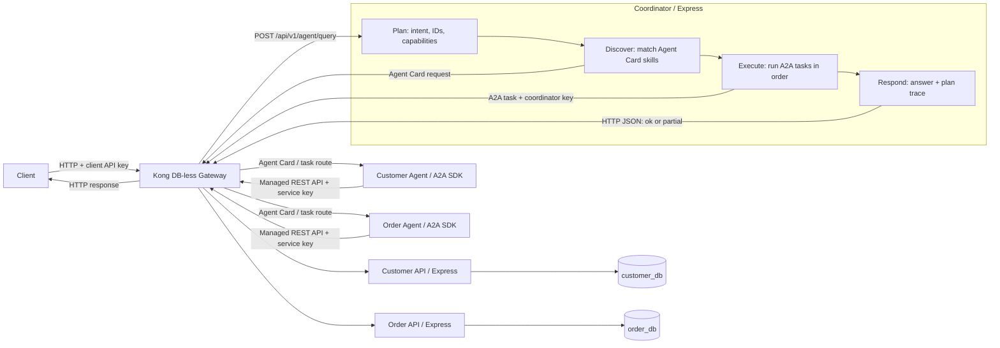

# Customer Service Integration Platform

ต้นแบบสำหรับ Technical Assessment ของ Partilon: ระบบ Customer และ Order แบบแยกบริการ พร้อม Kong Gateway และ Agent ที่ประสานงานผ่าน A2A

## สถาปัตยกรรม



บริการทั้งหมดเป็น Express + TypeScript; Customer API และ Order API เป็นเจ้าของ PostgreSQL คนละ database และคนละ role แม้ใช้ PostgreSQL container เดียว Agent ไม่มีสิทธิ์ต่อฐานข้อมูลโดยตรง

## เริ่มใช้งาน

ต้องมี Docker Desktop ที่เปิดใช้งาน Docker Compose ได้ และพอร์ต `8000` ว่าง คัดลอก `.env.example` เป็น `.env` เพื่อกำหนด port, timeout, log level และ PostgreSQL superuser password สำหรับการเริ่มฐานข้อมูลครั้งแรก; ถ้าไม่สร้าง `.env` Compose จะใช้ค่าเริ่มต้นเดียวกัน

```powershell
Copy-Item .env.example .env
docker compose up --build -d
docker compose ps
```

`.env.example` ตั้งค่า host ports, Coordinator timeout, application log level และ PostgreSQL superuser password; demo API keys กับ application database role passwords ยังคงกำหนดไว้ใน `kong/kong.yml` และ `db/init.sql` สำหรับ assessment นี้

รอจน services แสดงสถานะ `healthy` แล้วเรียก API ผ่าน `http://localhost:8000` โดยใช้ demo key `demo-client-key` ใน header `apikey`:

```powershell
curl.exe -H "apikey: demo-client-key" http://localhost:8000/api/v1/customers/C001
curl.exe -H "apikey: demo-client-key" http://localhost:8000/api/v1/orders/O1001
curl.exe -H "apikey: demo-client-key" "http://localhost:8000/api/v1/orders?customerId=C001&limit=1"
curl.exe -X POST http://localhost:8000/api/v1/agent/query -H "apikey: demo-client-key" -H "Content-Type: application/json" -d '{"query":"Find customer C001 and tell me their latest order status"}'
curl.exe -X POST http://localhost:8000/api/v1/agent/query -H "apikey: demo-client-key" -H "Content-Type: application/json" -d '{"query":"Show all orders for C001"}'
```

## ดู access logs และตาม request

Kong ส่ง access logs ไปที่ stdout โดยแต่ละบรรทัดมีเวลา, method, URI, HTTP status, เวลา request, upstream และ `X-Correlation-ID`; ดู logs ได้จาก terminal ด้วย Docker Compose:

```powershell
docker compose logs -f kong coordinator customer-agent order-agent customer-api order-api
```

Coordinator และ services ใช้ Pino เขียน structured logs เพิ่มรายละเอียดแผน, capability/Agent ที่เลือก และผลของแต่ละขั้นไว้ด้วย correlation ID เดียวกัน หากต้องการกรอง request ที่กำหนดเอง:

```powershell
docker compose logs --since 10m kong coordinator customer-agent order-agent customer-api order-api | Select-String "trace-demo-002"
```

Stack นี้ปิด Kong Admin API และไม่มีหน้า dashboard สำหรับ access logs; ใช้ `docker compose logs` ดู stdout ของ Kong และ services ได้เลย

การค้น `C999` ผ่าน Customer API หรือ Agent API คืน `404` พร้อมข้อความ `not_found`; ส่วนคำขอรวม customer กับ order จะทำงานตามลำดับ และแสดงผลบางส่วนอย่างชัดเจนหากไม่พบ order

## Agent ทำงานอย่างไร

- Coordinator แยกการทำงานเป็น Plan → Execute → Respond: สร้างแผนจาก query, เลือก capability จาก Agent Card ที่ค้นพบผ่าน Kong, ทำงานตามลำดับ และสรุปเฉพาะข้อมูลที่ดึงได้จริง
- ก่อนเรียก Agent ระบบ log แผนและ capability ที่จะใช้; response มี `meta.plan.steps` แสดง Agent ที่เลือกและผลของแต่ละขั้น เพื่อไล่การตัดสินใจด้วย `X-Correlation-ID`
- รองรับคำขอ order ล่าสุด (`latest`, `last`, `most recent`), order ทั้งหมด (`all`, `every`, `each`, `order history` หรือ `orders` แบบพหูพจน์) และค้น order ด้วย ID เช่น `O1001`; ถ้าระบุ order แบบเอกพจน์โดยไม่บอกช่วง ระบบใช้รายการล่าสุด
- การค้น order ทั้งหมดอ่านผ่านหน้า ๆ ละไม่เกิน 50 รายการ โดยเรียงจากใหม่ไปเก่า
- Coordinator ค้น Agent Card ของผู้สมัครและจับคู่ `skills[].id` กับ capability ที่ต้องการ ก่อนส่ง task แบบ A2A ผ่าน Kong; cache ในหน่วยความจำ 5 นาทีช่วยลด discovery traffic ส่วน Agent Card เผย metadata/skills และ A2A จัดการรูปแบบข้อความกับ task lifecycle
- หากขั้นหลังล้มเหลวหลังจากได้ข้อมูลบางส่วนแล้ว ระบบตอบ `200` พร้อม `status: "partial"`, `answer`, ข้อมูลที่ดึงสำเร็จ และ `issues`; ถ้าคำขอมีทั้ง customer กับ order จะตรวจ `order.customer_id` ให้ตรงกับ customer ก่อนตอบ
- คำขอที่มี customer ID หรือ order ID หลายรายการจะถูกปฏิเสธด้วย `400 AMBIGUOUS_QUERY` เพื่อไม่เลือก ID แรกอย่างเงียบ ๆ
- Specialist Agent เรียก API ผ่าน Kong ด้วย service key; API จึงเป็นทางเดียวที่อ่านข้อมูลจากฐานข้อมูล
- การตัดสินใจเป็น deterministic และไม่มี LLM, prompt หรือ API key ของผู้ให้บริการโมเดล จึงทำซ้ำผลได้ แต่ไม่เข้าใจคำถามทั่วไปนอกเหนือ ID และคำสำคัญที่รองรับ
- A2A ใช้สื่อสารระหว่าง Agent; การเรียก REST API เป็นการอ่านข้อมูล/เรียก capability ของระบบ ไม่ใช่การส่งงาน Agent-to-Agent

ตัวอย่างคำถามที่ Coordinator รองรับ: `C001`, `show customer C001`, `Name of C001 and their Order` (ตีความเป็น order ล่าสุด), `latest order for C001`, `Show all orders for C001`, `Show orders for C001`, `O1001` และคำถามที่ระบุทั้ง customer กับ order ID

## API routes

| Method | Route | รายละเอียด |
|---|---|---|
| GET | `/api/v1/customers/{customerId}` | อ่านข้อมูล customer |
| GET | `/api/v1/orders/{orderId}` | อ่าน order |
| GET | `/api/v1/orders?customerId=C001&limit=50&offset=0` | แสดง order ใหม่ไปเก่าแบบแบ่งหน้า; `limit` 1–50, `offset` 0–1,000,000 |
| POST | `/api/v1/agent/query` | มอบหมายงานให้ Coordinator |

ดูสัญญา API เพิ่มเติมที่ [OpenAPI](openapi/openapi.yaml) และเรียกตัวอย่างได้จาก [Postman collection](postman/Partilon-Assessment.postman_collection.json)

## ความปลอดภัยและความล้มเหลว

- Kong DB-less โหลด route/plugin จาก `kong/kong.yml`; ทุก route ต้องมี API key ใน `apikey`
- Demo ใช้ `demo-client-key` สำหรับ client, `coordinator-a2a-key` สำหรับ A2A ระหว่าง Coordinator กับ Agents และ `agent-internal-key` สำหรับ Agent เรียก managed APIs; แต่ละ consumer ถูกจำกัด 30 requests ต่อนาทีด้วย rate limiting แบบ local
- Kong สร้างหรือคง `X-Correlation-ID` เดิมไว้ แล้วส่งต่อผ่าน Coordinator, A2A task และ managed API calls; response และ logs ใช้ ID เดียวกัน
- Business API ตอบ 404 เมื่อไม่มี record; Agent query ตอบ `404` เมื่อไม่พบข้อมูล และตอบ `200 partial` เมื่อขั้นถัดไปล้มเหลวหลังมีผลสำเร็จแล้ว; ความล้มเหลวที่เกิดก่อนมีผลตอบ `503` หรือ `504` ตามสาเหตุ ห้าม Agent สร้างข้อมูลแทนผลที่ดึงไม่ได้
- ลองกรณีไม่มี key: `curl.exe -i http://localhost:8000/api/v1/customers/C001`; เรียกเกิน 30 ครั้งต่อนาทีด้วย key เดิมเพื่อดู `429`
- ลอง partial result เมื่อ dependency ล่ม: `docker compose stop order-api` แล้วถาม `Find customer C001 and tell me their latest order status`; ควรได้ `200` พร้อม customer, `status: "partial"` และ issue ว่าดึง order ไม่ได้ จากนั้นคืนระบบด้วย `docker compose start order-api`
- Kong สร้าง ID ให้อัตโนมัติ; หากต้องการกำหนด ID เพื่อไล่ trace เอง ส่ง `X-Correlation-ID` เข้ามาได้:

```powershell
curl.exe -i -H "apikey: demo-client-key" -H "X-Correlation-ID: trace-demo-001" http://localhost:8000/api/v1/customers/C001
curl.exe -i -X POST http://localhost:8000/api/v1/agent/query -H "apikey: demo-client-key" -H "X-Correlation-ID: trace-demo-002" -H "Content-Type: application/json" -d '{"query":"Find customer C001 and tell me their latest order status"}'
```

ค้น ID จาก response header `X-Correlation-ID` ใน logs ของ Kong, Coordinator, specialist agents และ APIs:

```powershell
docker compose logs -f kong coordinator customer-agent order-agent customer-api order-api
```

`docker compose down` หยุด services แต่เก็บข้อมูลไว้ใน volume; `docker compose down -v` ลบฐานข้อมูล demo และ seed ทั้งหมด

## โครงสร้างโฟลเดอร์

- `services/`: Express APIs, Coordinator และ specialist Agents
- `packages/shared/`: HTTP errors, request ID/logging, PostgreSQL pool และ A2A adapters
- `db/init.sql`: สร้าง database/roles/tables และ seed `C001`, `O1001`
- `kong/kong.yml`: declarative services, routes, key authentication และ rate limit
- `openapi/openapi.yaml`: API contract
- `postman/`: collection สำหรับสถานการณ์สาธิต
- `docs/architecture.md`: flow, decisions, assumptions และ limitations

## แผนอ่านเพื่อเรียนรู้และเลือก Agent technology

1. อ่าน [A2A Protocol](https://a2a-protocol.org/latest/) เพื่อเข้าใจ Agent Card, task และการสื่อสารระหว่าง Agent; ดู [A2A JavaScript SDK](https://github.com/a2aproject/a2a-js) สำหรับ Express adapter และ client ในตัวอย่างนี้
2. เทียบ orchestration แบบเขียนลำดับแน่นอนกับแบบให้โมเดลตัดสินใจใน [OpenAI Agents SDK: multi-agent](https://openai.github.io/openai-agents-js/guides/multi-agent/) และอ่าน [tools guide](https://openai.github.io/openai-agents-js/guides/tools/) เรื่องการเปิด capability ให้ agent เรียกใช้ เอกสารนี้เป็นแนวทางเรียนต่อ; โค้ดต้นแบบไม่ได้ติดตั้ง SDK ดังกล่าว
3. ทบทวน [Express 5 API](https://expressjs.com/en/5x/api/), [Express error handling](https://expressjs.com/en/5x/guide/error-handling/) และ [node-postgres pooling](https://node-postgres.com/features/pooling)
4. ทำความเข้าใจ [Kong DB-less](https://docs.konghq.com/gateway/latest/production/deployment-topologies/db-less-and-declarative-config/), [key authentication](https://docs.konghq.com/hub/kong-inc/key-auth/) และ [rate limiting](https://docs.konghq.com/hub/kong-inc/rate-limiting/configuration/)
5. เปรียบเทียบทางเลือก Gateway กับ [Apache APISIX architecture](https://apisix.apache.org/docs/apisix/architecture-design/apisix/): เดโมนี้เลือก Kong เพราะ declarative DB-less config ทำให้แพ็กและรีวิว topology ได้ในไฟล์เดียว; ก่อนใช้งานจริงให้เทียบความถนัดของทีม, plugin/feature ที่ต้องใช้, วิธีจัดการ config, observability และรูปแบบ deployment

## Assumptions และข้อจำกัด

- ใช้ Node.js 22 ใน container (สูงกว่าขั้นต่ำ Node.js 20), TypeScript, Express 5, PostgreSQL และ A2A JS SDK 1.x
- ฐานข้อมูลแยกเชิงตรรกะภายใน instance เดียว เพื่อลดเวลาตั้งระบบ; ไม่ได้แยก failure domain
- Kong มี gateway instance เดียวและ local rate-limit counter; ไม่ใช่ distributed quota
- A2A task store อยู่ใน memory; restart แล้ว task state หาย และ endpoint ภายในยังไม่มีการยืนยันตัวตนเฉพาะ A2A
- API key, password และข้อมูล seed ใน Compose เป็นค่าตัวอย่างสำหรับเครื่อง local เท่านั้น; อย่านำไปใช้ production
- การแยก Agent เป็น service สาธิต discovery และ delegation; กติกา query รองรับเฉพาะตัวอย่างใน assessment ไม่ใช่ general-purpose conversational agent
