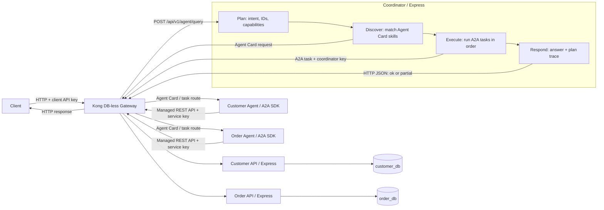

# Customer Service Integration Platform

ต้นแบบสำหรับ Technical Assessment ของ Partilon: บริการ Customer และ Order แยกกัน มี Kong เป็น API Gateway และมี Agent ที่ทำงานร่วมกันผ่าน A2A

## สถาปัตยกรรม



ทุกบริการเขียนด้วย Express + TypeScript Customer API และ Order API ใช้ PostgreSQL คนละ database คนละ role (แต่อยู่ใน container เดียวกัน) ส่วน Agent ไม่มีสิทธิ์เข้าถึงฐานข้อมูลโดยตรง ต้องเรียกผ่าน API เท่านั้น

## เริ่มใช้งาน

ต้องมี Docker Desktop (รองรับ Compose) และพอร์ต `8000` ว่างอยู่

```powershell
Copy-Item .env.example .env
docker compose up --build -d
docker compose ps
```

`.env` ใช้กำหนด host ports, Coordinator timeout, log level และรหัสผ่าน superuser ของ PostgreSQL ถ้าไม่สร้างไฟล์นี้ Compose จะใช้ค่าเริ่มต้นเดียวกัน ส่วน demo API keys และรหัสผ่านของ database role อยู่ใน `kong/kong.yml` และ `db/init.sql`

เมื่อทุก service ขึ้นสถานะ `healthy` ให้เรียกผ่าน `http://localhost:8000` โดยส่ง `demo-client-key` ใน header `apikey`:

```powershell
curl.exe -H "apikey: demo-client-key" http://localhost:8000/api/v1/customers/C001
curl.exe -H "apikey: demo-client-key" http://localhost:8000/api/v1/orders/O1001
curl.exe -H "apikey: demo-client-key" "http://localhost:8000/api/v1/orders?customerId=C001&limit=1"
curl.exe -X POST http://localhost:8000/api/v1/agent/query -H "apikey: demo-client-key" -H "Content-Type: application/json" -d '{"query":"Find customer C001 and tell me their latest order status"}'
curl.exe -X POST http://localhost:8000/api/v1/agent/query -H "apikey: demo-client-key" -H "Content-Type: application/json" -d '{"query":"Show all orders for C001"}'
```

หยุดระบบด้วย `docker compose down` (ข้อมูลยังอยู่ใน volume) หรือ `docker compose down -v` ถ้าต้องการล้าง database และ seed ทั้งหมด

## API

| Method | Route | รายละเอียด |
|---|---|---|
| GET | `/api/v1/customers/{customerId}` | อ่านข้อมูล customer |
| GET | `/api/v1/orders/{orderId}` | อ่านข้อมูล order |
| GET | `/api/v1/orders?customerId=C001&limit=50&offset=0` | รายการ order เรียงใหม่ไปเก่า แบ่งหน้า (`limit` 1–50, `offset` 0–1,000,000) |
| POST | `/api/v1/agent/query` | ส่งคำถามให้ Coordinator |

สัญญา API ฉบับเต็มอยู่ที่ [openapi/openapi.yaml](openapi/openapi.yaml) และมี [Postman collection](postman/Partilon-Assessment.postman_collection.json) สำหรับลองตามสถานการณ์สาธิต

## การทำงานของ Agent

Coordinator ทำงานเป็น 4 ขั้น: Plan → Discover → Execute → Respond

1. **Plan** อ่าน query แล้วหา intent, customer/order ID และ capability ที่ต้องใช้
2. **Discover** ดึง Agent Card ของ specialist agents ผ่าน Kong แล้วจับคู่ `skills[].id` กับ capability ที่ต้องการ (cache ใน memory 5 นาที)
3. **Execute** ส่ง A2A task ผ่าน Kong ตามลำดับ Specialist agent จะเรียก REST API ผ่าน Kong ด้วย service key อีกชั้นหนึ่ง
4. **Respond** สรุปคำตอบจากข้อมูลที่ดึงได้จริงเท่านั้น และแนบ `meta.plan.steps` เพื่อดูว่าเลือก Agent ไหนและแต่ละขั้นได้ผลอย่างไร

การตัดสินใจทั้งหมดเป็นกฎแบบ deterministic ไม่ใช้ LLM จึงไม่ต้องมี API key ของโมเดลและผลลัพธ์ซ้ำได้ แลกกับการที่ระบบเข้าใจเฉพาะ ID และคำสำคัญที่กำหนดไว้

**รูปแบบคำถามที่รองรับ:** `C001`, `show customer C001`, `latest order for C001`, `Show all orders for C001`, `O1001`, และคำถามที่ระบุทั้ง customer กับ order ID

**กติกาการตีความ**
- `latest` / `last` / `most recent` → order ล่าสุด
- `all` / `every` / `each` / `order history` หรือ `orders` พหูพจน์ → order ทั้งหมด (อ่านทีละหน้า หน้าละไม่เกิน 50 รายการ)
- ระบุ order เอกพจน์โดยไม่บอกช่วง → ใช้ order ล่าสุด
- ระบุ order ID เช่น `O1001` → ค้น order นั้นตรง ๆ
- มี customer หรือ order ID มากกว่าหนึ่งรายการ → ตอบ `400 AMBIGUOUS_QUERY` แทนที่จะเลือกตัวแรกเงียบ ๆ
- ถ้าคำถามมีทั้ง customer และ order จะตรวจว่า `order.customer_id` ตรงกับ customer ก่อนตอบ

A2A ใช้เฉพาะการส่งงานระหว่าง Agent ส่วนการเรียก REST API คือการอ่านข้อมูลจากระบบ ไม่ใช่การส่งงานระหว่าง Agent

## ความปลอดภัยและ traffic control

- ทุก route ใน Kong ต้องมี API key ใน header `apikey`
- มี 3 consumer แยกตามบทบาท: `demo-client-key` (client), `coordinator-a2a-key` (Coordinator เรียก Agent) และ `agent-internal-key` (Agent เรียก managed APIs)
- แต่ละ consumer จำกัด 30 requests ต่อนาที (rate limiting แบบ local)
- ทดสอบได้ เช่น เรียกโดยไม่ส่ง key (`curl.exe -i http://localhost:8000/api/v1/customers/C001`) จะได้ `401` และเรียกเกิน 30 ครั้งต่อนาทีจะได้ `429`

## การจัดการเมื่อเกิดข้อผิดพลาด

- Business API ตอบ `404` เมื่อไม่พบ record
- Agent query ตอบ `404` เมื่อไม่พบข้อมูล
- ถ้าขั้นหลังล้มเหลวหลังจากได้ผลบางส่วนแล้ว จะตอบ `200` พร้อม `status: "partial"`, ข้อมูลที่ดึงได้ และ `issues`
- ถ้าล้มเหลวก่อนมีผลใด ๆ จะตอบ `503` หรือ `504` ตามสาเหตุ
- Agent จะไม่สร้างข้อมูลแทนสิ่งที่ดึงไม่ได้

ลองดูได้ด้วยการ `docker compose stop order-api` แล้วถาม `Find customer C001 and tell me their latest order status` ควรได้ข้อมูล customer กลับมาพร้อม `status: "partial"` และ issue ว่าดึง order ไม่ได้ เสร็จแล้วใช้ `docker compose start order-api` เพื่อคืนระบบ

## ไล่ตาม request (observability)

Kong สร้าง `X-Correlation-ID` ให้อัตโนมัติ (หรือใช้ค่าที่ client ส่งมา) แล้วส่งต่อผ่าน Coordinator, A2A task และ API calls ทั้งหมด ค่าเดียวกันจะปรากฏใน response header และ log ทุกบริการ

```powershell
curl.exe -i -X POST http://localhost:8000/api/v1/agent/query -H "apikey: demo-client-key" -H "X-Correlation-ID: trace-demo-001" -H "Content-Type: application/json" -d '{"query":"Find customer C001 and tell me their latest order status"}'

docker compose logs -f kong coordinator customer-agent order-agent customer-api order-api
```

จากนั้นค้น `trace-demo-001` ใน logs เพื่อดู request ตั้งแต่ Kong ผ่าน Coordinator, Agents ไปจนถึง API Kong access log แสดงเวลา, method, URI, status, เวลาที่ใช้ และ upstream ส่วน application log ใช้ Pino แบบ structured

## โครงสร้างโฟลเดอร์

- `services/` – Express APIs, Coordinator และ specialist Agents
- `packages/shared/` – HTTP errors, request ID/logging, PostgreSQL pool และ A2A adapters
- `db/init.sql` – สร้าง database, roles, tables และ seed ข้อมูล (`C001`, `O1001`)
- `kong/kong.yml` – services, routes, key authentication และ rate limit
- `openapi/openapi.yaml` – API contract
- `postman/` – collection สำหรับสถานการณ์สาธิต
- `docs/architecture.md` – flow, decisions, assumptions และ limitations

## Technology choices

- **Node.js 22 + TypeScript** – รองรับ A2A JavaScript SDK และช่วยตรวจชนิดข้อมูลตอนพัฒนา
- **Express 5** – ใช้กับทั้ง APIs, Coordinator และ HTTP adapter ของ Agents
- **PostgreSQL 17** – แยก database และ role ของ customer กับ order
- **Kong Gateway 3.9.4 (DB-less)** – เก็บ routes และ plugins ไว้ในไฟล์เดียว (`kong/kong.yml`) รีวิวง่ายและรันด้วย Compose ได้เลย ถ้าจะใช้งานจริงควรเทียบกับตัวเลือกอื่นอย่าง Apache APISIX ตามความถนัดของทีมและ plugin ที่ต้องใช้
- **A2A JavaScript SDK 1.0.1** – ใช้ Agent Card และ task lifecycle
- **Pino + Docker Compose** – structured logs ไป stdout และรัน stack ในเครื่อง
- **ไม่ใช้ LLM framework** – การวางแผนเป็น TypeScript แบบ deterministic

## Architecture decisions

- แยก Customer API กับ Order API ตามเจ้าของข้อมูล แต่ละตัวเชื่อมเฉพาะ database และ role ของตัวเอง
- ทุกการเรียกระหว่าง client, services และ Agents ผ่าน Kong เพื่อให้ authentication, rate limiting และ correlation ID อยู่ที่จุดเดียว
- Agent อ่านข้อมูลผ่าน API เท่านั้น ไม่ต่อ database ตรง
- ใช้ A2A สำหรับการส่งงานระหว่าง Agent และใช้ REST สำหรับการอ่านข้อมูล

## Assumptions

- ประเมินและสาธิตบนเครื่องเดียวด้วย Docker Compose ข้อมูลทั้งหมดเป็น demo
- ใช้ PostgreSQL container เดียวเพื่อลดภาระการตั้งค่า (แยกที่ระดับ database และ role)
- คำถามอยู่ในขอบเขต customer/order lookup ตามตัวอย่างข้างต้น
- API keys และรหัสผ่านใน config เป็นค่า demo สำหรับ local เท่านั้น

## Known limitations

- Coordinator ใช้กฎและ keyword ที่กำหนดไว้ จึงไม่เข้าใจคำถามทั่วไปนอกขอบเขต
- มี Kong instance เดียวและ rate limit แบบ local ไม่มี quota ร่วมกันข้ามหลาย node
- Customer DB และ Order DB อยู่ใน PostgreSQL instance เดียว จึงใช้ failure domain ร่วมกัน
- Task state และ Agent Card cache อยู่ใน memory restart แล้วหาย และ cache อาจเก่าได้ถึง 5 นาที
- Logs ดูได้จาก Docker stdout เท่านั้น ไม่มี dashboard หรือการเก็บถาวร และ Kong access log ไม่ได้บันทึกชื่อ Consumer
- Express Agent endpoints บน Compose network ไม่มีการยืนยันตัวตนของตัวเอง ถ้าเรียกข้าม Kong ตรง ๆ จะผ่านได้

## Incomplete functionality

- ไม่มี LLM-based planning หรือการตอบแบบ conversational ทั่วไป
- ไม่มี persistent A2A task history, retry/resume หลัง Agent restart และ distributed tracing backend
- ไม่มี Kong Manager, traffic analytics UI หรือระบบเก็บ/ค้น log ส่วนกลาง
- Automated tests ครอบคลุม planner เป็นหลัก ส่วน API และ failure scenarios ทดสอบผ่าน Postman ด้วยมือ ยังไม่มี automated end-to-end test
- ไม่มี production secret management, workload identity หรือ hardening สำหรับ deploy นอกเครื่อง assessment
