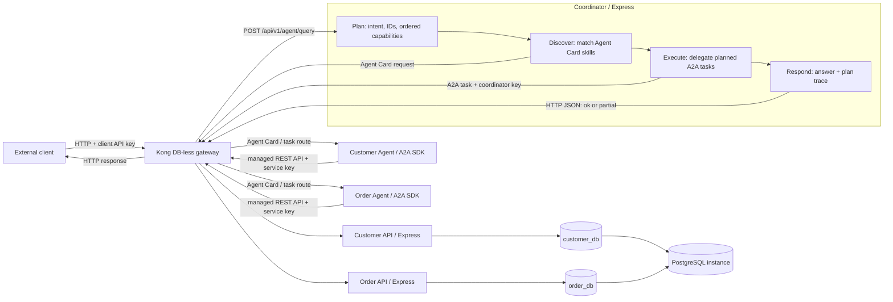

# Architecture and decisions

## Request flow

1. The client calls a public route through Kong with the `apikey` header.
2. Kong authenticates the consumer, enforces a per-consumer local rate limit, and creates or preserves `X-Correlation-ID`. The ID is echoed in the response and written into Kong's access log.
3. The Coordinator plans the work from customer/order IDs and order intent, logs the plan, discovers an Agent Card through Kong, and matches its advertised skill to each planned capability. It delegates work through Kong using A2A task messages carrying the same correlation ID and a dedicated coordinator key.
4. Specialist agents call the Customer or Order REST API through Kong using the separate internal API key and forward `X-Correlation-ID`. They never connect to PostgreSQL.
5. The Coordinator executes the plan in order and responds with retrieved data only. Its response includes a readable `answer` and `meta.plan.steps` with each selected Agent and step status. If a later step fails after an earlier step succeeded, it returns `200` with `status: "partial"`, the successful data, and an `issues` entry.

## Access logs and request observability

Kong writes proxy access logs to stdout. Each entry records time, method, URI, HTTP status, total request time, upstream address/status/response time, and `X-Correlation-ID`. Use `docker compose logs -f kong` to view Gateway requests. Express services write structured Pino logs to stdout with the same correlation ID; Coordinator entries include the planned capabilities, selected Agent, and step outcome. Follow one end-to-end request with `docker compose logs --since 10m kong coordinator customer-agent order-agent customer-api order-api | Select-String "<correlation-id>"`. This prototype uses container logs directly; the Kong Admin API is disabled, so it has no Kong Manager UI or separate log dashboard.

## A2A interaction

1. Customer Agent and Order Agent publish Agent Cards at `/.well-known/agent-card.json`. Kong exposes each card under `/a2a/customer-agent/.well-known/agent-card.json` and `/a2a/order-agent/.well-known/agent-card.json`; each card advertises its Kong A2A URL, name, supported HTTP+JSON interface, and skills.
2. The Coordinator plans customer/order IDs and classifies order intent as latest, all, or a specific order ID using deterministic TypeScript rules. A singular unqualified order request defaults to latest; plural `orders` defaults to all. The A2A SDK client discovers candidate cards through Kong and selects a card by matching `skills[].id`, then submits the task through the same gateway under `/a2a/{agent}/message:send`.
3. The task carries a text part containing the action payload (for example, `get_customer`, `latest_order`, `all_orders`, or `get_order` with the relevant ID) and the end-to-end `requestId`.
4. The specialist agent moves the task through submitted, working, and completed states. It invokes the managed REST API through Kong, then returns the retrieved result as a task artifact.
5. The Coordinator reads the artifact, records each step outcome, and responds with a readable summary, retrieved data, and the plan trace under the same correlation ID. A missing record is represented as not found; an unavailable dependency is returned as an error or an explicit partial result rather than invented data.

Kong authenticates A2A discovery and task calls with the dedicated `coordinator-a2a-key`; specialist REST calls use `agent-internal-key`. The Coordinator/A2A client implementation is in `services/coordinator/src/index.ts` and `packages/shared/src/a2a-client.ts`. Agent Cards, task execution, and task artifacts are implemented in `packages/shared/src/agent-server.ts`; Customer and Order capabilities are in their corresponding `services/*-agent/src/index.ts` files.

## Decisions and limits

- Kong uses DB-less declarative configuration. The gateway does not need a separate Kong PostgreSQL database. This prototype runs one gateway node and uses its local rate-limit policy.
- Customer and Order own separate PostgreSQL databases and database roles inside one PostgreSQL container. This demonstrates logical ownership, not independent database availability.
- The Coordinator is an API-facing A2A client. Customer Agent and Order Agent expose A2A v1.0 Agent Cards and tasks through the official JavaScript SDK's Express HTTP+JSON/REST adapter.
- Agent routing is deterministic and follows a Plan → Execute → Respond flow. The plan supports a defined set of English and Thai order-intent keywords, customer/order IDs, latest-order requests, all-orders requests, and singular-order defaults. Multiple distinct IDs of the same type are rejected as ambiguous. It does not perform general-purpose natural-language understanding and does not call an LLM.
- Successfully discovered Agent Cards are cached in Coordinator memory for five minutes to reduce repeated Gateway discovery traffic. A Coordinator restart clears this cache, and a changed Agent Card can take up to five minutes to be observed.
- When a request contains both a customer ID and an order ID, the Coordinator checks that the returned order's `customer_id` matches the requested customer before returning either record together.
- A2A task state is stored in memory and is lost when an agent restarts. Gateway routes require an internal API key, but the Express agent endpoints do not authenticate callers that bypass Kong on the Compose network; production should add network policy and workload identity or end-to-end authentication, persistent task storage, and distributed tracing.
- Static API keys and seeded customer data are demonstration values only. Replace them before any deployment outside a local assessment environment.

## Error behavior

- Customer and order APIs return `400` for invalid IDs or query parameters and `404` when a requested record does not exist.
- Agent query returns `404` with `status: "not_found"` when a requested record is missing or a requested order belongs to a different customer.
- If the customer lookup succeeds but the requested order is missing, or a later Agent/dependency step fails, the Coordinator returns `200` with `status: "partial"`, the customer result, and a structured `issues` entry. A failure before any step succeeds returns `503`; a delegated task timeout before any result succeeds returns `504`.
- Invalid or ambiguous plans return `400`; for example, a query that includes two distinct customer IDs is rejected instead of silently using the first one.
- Errors from Express services use `{ "error": { "code", "message", "requestId" } }`. Kong-generated `401` and `429` responses use the gateway's response format.
- Express access logs, A2A task completion logs, API responses, and Kong access logs share the same `X-Correlation-ID` for one end-to-end request. Express accepts only short, log-safe characters in a caller-supplied correlation ID.

